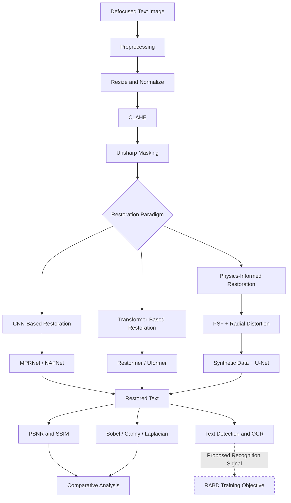
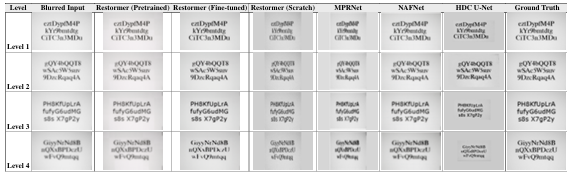

<div align="center">

# Recognition-Aware Blind Deblurring for Degraded Text Images

### A Comparative Analysis of Restoration Paradigms for Optical-Defocus Text

[](#project-overview)
[](#methodology)
[](#dataset)
[](#restoration-approaches)

**Sri Jayaram J S · Sushil V · Praneeth U · Adithya Nambiar P · Rachit Anand**

*Advisor: Dr. Padmavathi S.*

Department of Computer Science and Engineering  
Amrita School of Computing, Amrita Vishwa Vidyapeetham, Coimbatore, India

</div>

---

## 📌 Table of Contents

- [Project Overview](#project-overview)
- [Objectives](#objectives)
- [Research Contributions](#research-contributions)
- [Methodology](#methodology)
- [Restoration Approaches](#restoration-approaches)
- [Dataset](#dataset)
- [Experimental Setup](#experimental-setup)
- [Combined Model Results](#combined-model-results)
- [Detailed Results](#detailed-results)
- [Structural Edge Analysis](#structural-edge-analysis)
- [Recognition-Aware Blind Deblurring](#recognition-aware-blind-deblurring-rabd)
- [Key Findings](#key-findings)
- [Suggested Repository Structure](#suggested-repository-structure)
- [Reproducibility](#reproducibility-and-usage)
- [Limitations](#limitations)
- [Future Work](#future-work)
- [References](#references)
- [Acknowledgements](#acknowledgements)

---

## 🔎 Project Overview

Optical defocus is a common source of degradation in camera-captured text images. Incorrect focus weakens character boundaries, merges neighbouring characters, and removes fine structural details, reducing the reliability of Optical Character Recognition (OCR).

This project presents a comparative study of restoration approaches for degraded text images using the **Helsinki Deblur Challenge 2021 (HDC 2021)** benchmark and its `focusStep` subset.

Three restoration paradigms are investigated:

- **CNN-based restoration:** MPRNet and NAFNet.
- **Transformer-based restoration:** Restormer and an exploratory Uformer implementation.
- **Physics-informed restoration:** A U-Net trained using degradation-matched synthetic data generated from estimated point-spread functions and radial lens distortion.

The study also investigates the preservation of character boundaries through Sobel, Canny, and Laplacian edge operators.

Finally, it formulates **Recognition-Aware Blind Deblurring (RABD)**, a proposed approach that combines image reconstruction and text-recognition objectives to encourage restoration of OCR-relevant information.

> **Research status:** RABD is a proposed formulation and has not been evaluated end-to-end. Uformer is an exploratory implementation without a completed common-protocol quantitative evaluation.

## 🎯 Objectives

1. Compare CNN-based, transformer-based, and physics-informed restoration approaches.
2. Investigate zero-shot domain transfer and target-domain fine-tuning.
3. Compare pretrained restoration models with a lightweight Restormer trained from scratch.
4. Model optical degradation using point-spread functions (PSFs) and radial lens distortion.
5. Evaluate restoration using Peak Signal-to-Noise Ratio (PSNR) and Structural Similarity Index Measure (SSIM).
6. Examine character-boundary preservation using Sobel, Canny, and Laplacian operators.
7. Formulate a recognition-aware restoration objective for future OCR-oriented evaluation.

## 🧪 Research Contributions

| Contribution | Description |
|---|---|
| Cross-paradigm comparison | Study of CNN, transformer, and physics-informed restoration |
| Domain-shift analysis | Investigation of zero-shot transfer, target-domain adaptation, and pretrained versus from-scratch learning |
| Physics-informed restoration | Estimation of blur kernels and radial-distortion parameters for domain-matched synthetic data |
| Structural analysis | Use of edge operators to examine recovered character boundaries |
| Recognition-aware formulation | Proposal of RABD combining recognition and reconstruction losses |

## 🧭 Methodology

The general framework consists of preprocessing, restoration, structural analysis, and downstream text-processing stages.



The restoration module is interchangeable across the evaluated paradigms. Edge operators are downstream structural probes, not competing restoration models. The RABD training pathway represents a proposed extension and was not used in the reported restoration experiments.

### Preprocessing

The preprocessing sequence described in the paper includes:

- Resizing images to a common resolution.
- Normalizing pixel values to the range `[0, 1]`.
- Applying Contrast Limited Adaptive Histogram Equalization (CLAHE).
- Applying unsharp masking to emphasize high-frequency character information.

## 🧠 Restoration Approaches

### 1. CNN-Based Restoration

**MPRNet**

MPRNet performs progressive multi-stage restoration using Cross-Stage Feature Fusion (CSFF) and Supervised Attention Modules (SAM).

- Uses publicly released GoPro-pretrained weights.
- Evaluated without fine-tuning on HDC focusStep Levels 0–4.
- Used to investigate zero-shot transfer from motion deblurring to optical-defocus text.

**NAFNet**

NAFNet uses activation-free restoration blocks based on SimpleGate and Simplified Channel Attention.

- Fine-tuned on focusStep Levels 1–4.
- Uses L1 reconstruction loss.
- Employs patch-based training and tiled inference.
- Provides a comparison between pretrained performance and target-domain adaptation.

### 2. Transformer-Based Restoration

**Restormer — Fine-Tuned**

- Initialized using a publicly released checkpoint pretrained on the DPDD dual-pixel defocus dataset.
- Encoder frozen during fine-tuning.
- Decoder and refinement stages fine-tuned on focusStep Levels 0–4.
- Uses Charbonnier reconstruction loss and 128 × 128 training patches.

**Restormer — From Scratch**

- Lightweight architecture with approximately 1.18 million parameters.
- Trained from random initialization on the complete 20-step HDC 2021 release.
- Uses an 80/20 train-test split.
- Evaluated using full-image PSNR and SSIM.

**Uformer**

- Implemented as an additional transformer-based architecture.
- Uses a width-16 configuration with 8 × 8 attention windows.
- Retained as an exploratory model because a complete evaluation using the common quantitative protocol was not completed.

### 3. Physics-Informed Restoration

The physics-informed pipeline follows the HDC 2021 winning approach.

It explicitly models optical degradation using:

- Point-spread function estimation.
- Radial lens-distortion estimation.
- Synthetic sharp/blurred pair generation.
- Level-specific U-Net pretraining.
- Fine-tuning using real and synthetic image pairs.

The objective is to incorporate information about the image-formation process rather than relying exclusively on learned image statistics.

## 🗂️ Dataset

The experiments use the **Helsinki Deblur Challenge 2021 (HDC 2021)** benchmark and its `focusStep` subset.

| Property | Description |
|---|---|
| Dataset | Helsinki Deblur Challenge 2021 |
| Image type | Camera-captured printed text with optical defocus |
| Image format | 16-bit grayscale TIFF |
| Image dimensions | 1460 × 2360 pixels |
| Fonts | Times New Roman (`timesR`) and Verdana (`verdanaRef`) |
| Font size | 30 pt |
| Full release | 20 defocus steps, 0–19 |
| focusStep subset | Levels 0–4 |
| References | Corresponding focused images |
| Pairing strategy | Exact filename matching |

The dataset contains progressively increasing degradation levels. The underlying text content differs across blur levels, so blurred images are paired with their focused references using exact filenames rather than assuming identical text across levels.

**Dataset resource:** [Helsinki Deblur Challenge 2021](https://www.fips.fi/HDC2021.php)

The dataset is not included in this repository. Follow the provider's access and usage conditions.

## ⚙️ Experimental Setup

Experiments were conducted using Google Colab and Kaggle GPU environments.

| Method | Dataset | Training strategy | Evaluation |
|---|---|---|---|
| MPRNet | focusStep Levels 0–4 | GoPro-pretrained; zero-shot inference | PSNR / SSIM |
| NAFNet | focusStep Levels 1–4 | Full-model fine-tuning; L1 loss; 256 × 256 crops | PSNR / SSIM |
| Restormer (fine-tuned) | focusStep Levels 0–4 | DPDD initialization; frozen encoder; Charbonnier loss | PSNR / SSIM |
| Restormer (from scratch) | HDC Steps 0–19 | Approximately 1.18M parameters; 120 epochs; 80/20 split | Full-image PSNR / SSIM |
| Uformer | HDC Steps 0–4 | Width 16; 8 × 8 attention windows | Exploratory evaluation |
| Physics-informed U-Net | HDC Levels 0–9 | Level-specific synthetic pretraining and real/synthetic fine-tuning | PSNR / SSIM where reported |

The individual studies use different subsets and evaluation protocols. Results must therefore be interpreted within their respective experimental settings.

---

## 📊 Combined Model Results

The following visualization consolidates numerical results reported in the paper for MPRNet, NAFNet, Restormer, and the physics-informed U-Net.



> **Interpretation note:** These panels summarize reported results under different datasets, defocus levels, and evaluation protocols. They are not a single controlled ranking. The MPRNet line joins only its two reported endpoints.

## 📈 Detailed Results

### 1. MPRNet — Zero-Shot Domain Transfer

MPRNet was evaluated using GoPro-pretrained weights without fine-tuning on the target optical-defocus domain.

| Metric | Reported result |
|---|---:|
| Level 0 PSNR | 22.12 dB |
| Level 4 PSNR | 12.93 dB |
| Overall PSNR across 40 validation images | 17.11 dB |
| Overall SSIM | 0.4085 |

![MPRNet PSNR endpoints]

The decline in PSNR from Level 0 to Level 4 indicates the effect of applying a model trained for motion deblurring to optical-defocus text.

The paper reports a 15.55 dB reduction relative to the published GoPro result of 32.66 dB.

### 2. NAFNet — Impact of Fine-Tuning

| Metric | Reported result |
|---|---:|
| Pretrained PSNR across Levels 1–4 | 5.33–5.63 dB |
| Fine-tuned PSNR across Levels 1–4 | 12.59–15.26 dB |
| Fine-tuned SSIM across Levels 1–4 | 0.482–0.507 |
| Largest PSNR improvement | +9.63 dB at Level 3 |
| Largest reported SSIM improvement | +0.211 at Level 3 |

![NAFNet adaptation comparison]

The pretrained NAFNet checkpoint performs poorly on the target domain, with reported PSNR below the corresponding blurred-input values. Target-domain fine-tuning produces substantial recovery in the evaluated levels.

### 3. Restormer — Fine-Tuning

The DPDD-pretrained Restormer was adapted to the optical-defocus text domain.

| Defocus level | Reported PSNR change |
|---|---:|
| Level 1 | +3.21 dB |
| Level 2 | +1.54 dB |
| Level 3 | +0.44 dB |
| Level 4 | −0.36 dB |

The fine-tuned model reaches 24.88 dB PSNR at Level 1. At Level 4, PSNR decreases slightly, although SSIM still improves.

### 4. Restormer — Training from Scratch

The lightweight Restormer was trained on all 20 HDC steps using random initialization.

| Evaluation setting | PSNR | SSIM |
|---|---:|---:|
| Training patches at epoch 120 | 21.48 dB | 0.4988 |
| Best full-image test result, Step 1 | 15.66 dB | 0.3876 |
| Step 5 | 13.20 dB | 0.2416 |
| Step 10 | 11.56 dB | 0.2276 |
| Step 15 | 9.88 dB | 0.2170 |
| Step 17 | 8.66 dB | 0.2090 |

The difference between training-patch performance and full-image test performance highlights the importance of full-image evaluation and the difficulty of learning effective restoration from limited target-domain data.

### 5. Physics-Informed U-Net

| Evaluation setting | PSNR | SSIM |
|---|---:|---:|
| Level 5, beginning of fine-tuning | 15.95 dB | Not reported |
| Level 5, after fine-tuning | 17.43 dB | 0.589 |
| Level 6, after synthetic pretraining | 14.20 dB | 0.579 |

The estimated PSF peak decreases from 0.356 at Level 0 to 0.010 at Level 4, while the reported radial-distortion coefficient K1 changes from −0.014 to +0.021.

These results illustrate the use of explicit degradation modelling and domain-matched synthetic data. They do not establish a universal performance ranking against the other restoration approaches.

## 🔬 Structural Edge Analysis

Sobel, Canny, and Laplacian operators are applied to selected restored outputs to examine character-boundary preservation.

![Structural edge analysis metrics]

| Operator | Precision | Recall | F1-score |
|---|---:|---:|---:|
| Sobel | 0.1124 | 0.9095 | 0.1994 |
| Canny | 0.1362 | 0.2159 | 0.1610 |
| Laplacian | Not reported | 0.0090 | 0.0167 |

**Observations**

- **Sobel:** Highest recall, but produces many false-positive edges.
- **Canny:** Provides a more balanced response among the evaluated operators.
- **Laplacian:** Produces the lowest reported recall and F1-score.

These operators are structural diagnostic tools. They are not competing image-restoration methods.

## 🧩 Recognition-Aware Blind Deblurring (RABD)

The study proposes Recognition-Aware Blind Deblurring as an extension of conventional restoration objectives.

The proposed total training loss is:

\[
\mathcal{L}_{total}
=
\lambda_1\mathcal{L}_{CTC}
+
\lambda_2\mathcal{L}_{Charbonnier}
\]

Where:

- \(\mathcal{L}_{CTC}\) represents the recognition loss.
- \(\mathcal{L}_{Charbonnier}\) measures reconstruction error between the restored image and the sharp reference.
- \(\lambda_1\) and \(\lambda_2\) control the relative contributions of the two objectives.

The intended formulation propagates recognition gradients through the recognition network into the deblurring network, encouraging the restoration model to preserve information useful for downstream text recognition.

> **Implementation status:** RABD is proposed in the paper but has not been evaluated end-to-end. No OCR improvement is claimed.

## 💡 Key Findings

1. **Domain adaptation matters.** Restoration performance depends strongly on the relationship between training degradation and target degradation.
2. **Fine-tuning improves target-domain results.** NAFNet and Restormer show benefits from adapting to optical-defocus text.
3. **Pretraining provides useful representations.** The lightweight Restormer trained from scratch exhibits a gap between patch-level training and full-image testing.
4. **Physics-informed modelling offers an alternative.** Explicit PSF and radial-distortion estimation can support domain-matched synthetic training.
5. **Structural analysis complements image metrics.** Edge-map analysis reveals character-boundary behaviour not fully described by PSNR and SSIM.
6. **OCR performance requires direct evaluation.** Image-quality metrics alone do not establish improved text recognition.

## 📏 Evaluation Metrics

| Metric | Purpose |
|---|---|
| PSNR | Measures pixel-level reconstruction fidelity against a sharp reference |
| SSIM | Measures structural similarity between restored and reference images |
| Precision | Measures the proportion of detected edges that match reference edges |
| Recall | Measures the proportion of reference edges recovered |
| F1-score | Combines edge precision and recall |
| CER | Proposed future metric for character-recognition errors |
| WER | Proposed future metric for word-recognition errors |

CER and WER are identified as future evaluation directions for the end-to-end RABD pipeline, not as completed results of the present study.

## 📁 Suggested Repository Structure

The following structure is a recommendation for organizing the implementation. It is not a claim that these exact directories already exist.

```text
.
├── README.md
├── assets/
│   ├── combined_model_results.png
│   ├── mprnet_psnr_endpoints.png
│   ├── nafnet_adaptation.png
│   └── edge_probe_metrics.png
├── configs/
├── data/
├── notebooks/
├── src/
│   ├── preprocessing/
│   ├── models/
│   ├── physics_informed/
│   ├── evaluation/
│   └── recognition/
├── outputs/
└── requirements.txt
```

Do not commit the full dataset, large checkpoints, or generated outputs without checking licensing, storage requirements, and repository policies.

## ▶️ Reproducibility and Usage

The paper describes the experimental settings and model configurations but does not specify a complete command-line interface or a consolidated dependency list.

Before publishing execution commands, document the following:

1. Python, CUDA, and verified package versions.
2. Dataset download instructions and directory layout.
3. Exact filename matching between blurred images and focused references.
4. Preprocessing settings.
5. Pretrained checkpoint sources and licenses.
6. Model-specific training and inference commands.
7. Full-image evaluation procedures for PSNR, SSIM, and edge metrics.

Add commands only after verifying them against the actual implementation.

## ⚠️ Limitations

- Evaluation protocols differ across the model studies.
- Zero-shot MPRNet evaluation is restricted to focusStep Levels 0–4.
- The highest-defocus physics-informed experiments are incomplete.
- Uformer does not have a completed common-protocol quantitative evaluation.
- RABD has not been evaluated end-to-end using OCR metrics.
- PSNR and SSIM do not directly measure OCR performance.

## 🔭 Future Work

- Fine-tune MPRNet on the focusStep domain and extend evaluation to HDC Steps 5–19.
- Evaluate Uformer using the same quantitative protocol as the primary models.
- Investigate the full multi-scale NAFNet architecture with its global residual connection.
- Complete physics-informed experiments for higher-defocus levels.
- Investigate level-conditioned physics-informed U-Net models.
- Explore learned edge detectors such as DexiNed.
- Evaluate frequency-domain and multi-scale restoration strategies.
- Implement RABD end-to-end using a recognition backend such as CRNN or TrOCR.
- Evaluate OCR performance using CER, WER, and character-level accuracy.

## 📚 References

The following are selected references from the research paper.

1. Finnish Inverse Problems Society, [Helsinki Deblur Challenge 2021](https://www.fips.fi/HDC2021.php), 2021.
2. T. Trippe, M. Genzel, J. Macdonald, and M. Marz, “Let's enhance: A deep learning approach to extreme deblurring of text images,” *Inverse Problems and Imaging*, vol. 17, no. 6, 2023. [https://doi.org/10.3934/ipi.2023019](https://doi.org/10.3934/ipi.2023019).
3. S. W. Zamir et al., “Multi-stage progressive image restoration,” *CVPR*, 2021.
4. L. Chen, X. Chu, X. Zhang, and J. Sun, “Simple baselines for image restoration,” *ECCV*, 2022.
5. J. Liang et al., “SwinIR: Image restoration using Swin Transformer,” *ICCV Workshops*, 2021.
6. S. W. Zamir et al., “Restormer: Efficient Transformer for High-Resolution Image Restoration,” *CVPR*, 2022.
7. Z. Wang et al., “Uformer: A General U-Shaped Transformer for Image Restoration,” *CVPR*, 2022.
8. M. Yang et al., “Towards understanding text degradation robustness of OCR systems,” arXiv:2003.10123, 2020.

See the original research paper for the complete bibliography.

## 🙏 Acknowledgements

The authors acknowledge:

- The Department of Computer Science and Engineering, Amrita Vishwa Vidyapeetham, Coimbatore, for academic and technical support.
- The Finnish Inverse Problems Society for making the HDC 2021 dataset publicly available.
- Google Colab and Kaggle GPU environments for computational resources.
- The HDC 2021 winning pipeline by Trippe et al. as the basis for the physics-informed restoration study.

---

<div align="center">

**Recognition-Aware Blind Deblurring for Degraded Text Images**

*Investigating how restoration architecture, domain adaptation, and explicit degradation modelling influence text-image restoration.*

</div>
